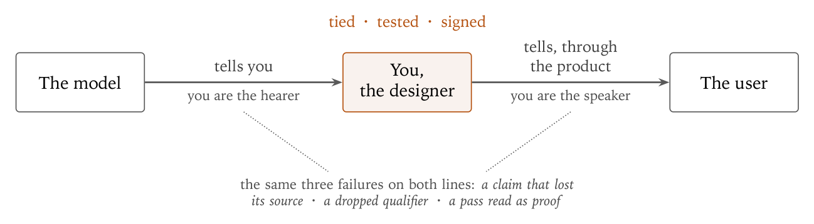
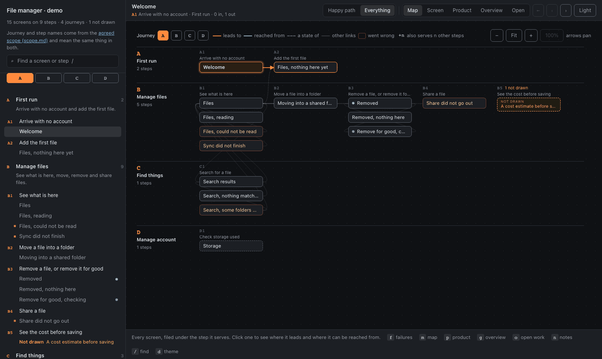
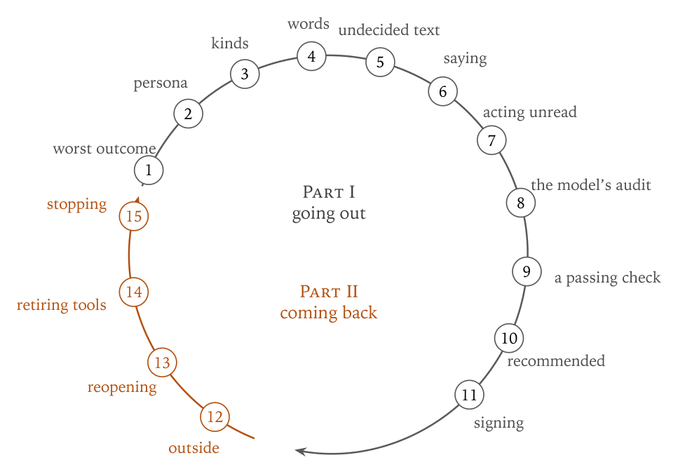

# examined-design

**Every claim, on a screen or in the record, should say what it rests on, and a person should answer for it.**

A method and a working harness for designing with an AI model. When you design with a model you
stand between two lines of testimony: the model tells you things, and through the product you tell
users things. The same failures turn up on both lines — a claim that lost its source, a dropped
qualifier, a pass read as proof — and one discipline answers them. That discipline, the argument
for it, and the case it came from are in the paper,
[*Examined Design*](docs/paper/examined-design.pdf).



A claim is **examined** when it is *tied* (it says what it rests on), *tested* (it has met the
strongest objection anyone found) and *signed* (a person answers for it). Examination is necessary,
not sufficient: an examined design can still be wrong; an unexamined one is right only by luck.

[](https://github.com/VeghV03/measured-design-skills/actions/workflows/ci.yml)
[](LICENSE)

## The harness

One HTML file is the prototype: your design system, every board, what each board means, and a viewer.
It opens from disk with the network off. Nothing to install to read it.



The viewer has five views — the **map** of journeys and steps, one **screen** at a time with its
notes, the **product** as places, states, detours and entrances, an **overview** of every board, and
**open** work (gaps, open decisions, screens that will change, gates) — and a switch that hides the
failure states to show the happy path. Hotspots are bound by text: a link is `[label, target]`, and
the label must be on the board.

Start one:

```sh
python3 harness/protolib.py new prototype.html --title "My product"
```

Then change it the way the demo was made: **one small patch script per change**, kept as the record
of what changed and why, every text replacement asserting how many times it occurs. Each patch ends
in `save()`, which computes the derived fields and **refuses** — writing nothing — if a link label is
not on its board or any id does not resolve. Everything else it reports as a number for a person to
weigh. After every patch, render and look at every board you touched, in light and dark:

```sh
python3 harness/render.py prototype.html Files FilesReadFailed --both
```

The worked example builds a fifteen-board file manager from an empty file in thirteen patches,
including one that fixes what the checks found: [`examples/demo`](examples/demo), walked through step
by step in the [tutorial](docs/tutorial.md). The [reference](docs/reference.md) has the data contract,
the viewer, the tools and the checks.

## The loop



The method is fifteen questions, one per article of the paper, carried by eleven stage skills:

| Going out | | Coming back | |
|---|---|---|---|
| `examined-design-frame` | the worst outcome; the persona as a yardstick | `examined-design-outside` | a check from neither you nor the model |
| `examined-design-structure` | kinds that oblige; words that imply | `examined-design-reopen` | only with a named objection, then say why the old answer looked right |
| `examined-design-draw` | nothing undecided ships; say what was observed; nothing irreversible on an unread fact | `examined-design-retire` | retire tools openly; claims answer only to truth |
| `examined-design-audit` | the model compares, you check what it found and what it did not | `examined-design-stop` | Ready, written first; ship with the unchecked named |
| `examined-design-measure` | a pass means "not refuted on this one condition" | | |
| `examined-design-decide` | multiple choice, with the case for another option, explained back | | |
| `examined-design-ship` | every string traces to a decision with a name | | |

`examined-design` is the entry point and `examined-design-harness` is the contract; read both before
drawing anything. `examined-design-drift` compares the scope document with the prototype (the
prototype dictates), and `examined-design-backlog` turns the prototype into planned work.

## The checks

Thirteen checks run against a prototype, a folder of built pages, or a running app. Each prints one
number, and each says in its first lines **what it cannot see**:

```sh
node cli/examined.mjs init       # finds the prototype (or the app), writes examined.config.json, runs them
node cli/examined.mjs baseline   # freeze today's findings
node cli/examined.mjs check --no-new
node cli/examined.mjs waive <fingerprint> --why "…" --until 2027-01-01
```

(`npm link` in this folder makes the command available as `examined`. It is not published on npm.)

| Check | What a pass shows | What it cannot see |
|---|---|---|
| `contrast` (light, dark) | the colour that reaches the eye — text composited through every background beneath it and any translucent layer above it — clears 4.5:1 (3:1 large) | gradients and images behind text; text whose centre is clear but edges are not |
| `translucency` | no large translucent layer dims the text under it below 4.5:1 | layers under 200px a side; modals (dimmed on purpose) |
| `overflow` | nothing falls off the frame | an element overflowing its own cell; content clipped by `overflow:hidden` |
| `cellfit` | no chip is wider than the cell holding it | anything that is not a chip; text cut off by an ellipsis |
| `structure` | a heading, labelled controls, no colour-only status, lines under 40em | whether the heading says the right thing; whether a label says what the control does |
| `vocab` | no forbidden word outside the zone that allows it | whether the words that pass are understood |
| `routes` | every declared link binds to text on its board | whether it goes to the right board |
| `target-size` | no target under 24px | a target no control selector matches (a design system that draws buttons as spans names them in `meta.controls`) |
| `motion` | nothing animates under reduced motion | motion driven by script; motion that starts on interaction |
| `density` | element count under budget | whether the board was drawn at the real data scale |
| `lang` | `<html lang>` is set | whether it is the right language; a passage in another language |
| `offline` | the file opens with the network refused | a request made only after someone interacts |
| `links` (apps only) | nothing same-origin 404s | whether a link goes to the right page; that a declared route map exists at all |

`structure` and `target-size` can only fail on controls they recognise. When they find none on any
board they say so, rather than passing quietly.

Version 1 of `contrast` claimed to composite and read declared colours instead; it passed text at
4.74:1 that reached the eye at 2.53:1. `checks/test-fixtures.mjs` now runs the veil case on every push:
the veil must fail, the same page without it must pass.

**Nobody fixes 158 things; everybody can stop the 159th.** A baseline freezes what is there, `--no-new`
fails only on what is new, and a waiver is a decision with a reason and a date — never a deleted check.

## The backlog

```sh
python3 backlog/build_backlog.py --prototype prototype.html
```

Journeys become epics, steps become stories, boards become sub-tasks carrying their **required text,
quoted exactly with "(proto: Board)"**, and every open decision becomes a spike that blocks what it
holds up. It writes `backlog.md` to read and `jira.csv` to import; `--push` creates issues, after
asking. It never writes the "so I can" of a story: that slot stays blank and is counted. For a project
without a prototype, `skills/jira-backlog` plans from a brief, a running app or a codebase.

## Install the skills

```sh
sh scripts/install.sh claude          # ~/.claude/skills
sh scripts/install.sh codex           # ~/.agents/skills
sh scripts/install.sh any ./skills    # anywhere else
```

Claude Code can also add this folder as a plugin marketplace (`.claude-plugin/marketplace.json`).
The skills pair well with general designer skill packs (for example *designer-skills*, MIT, MC Dean),
installed separately; nothing here depends on them.

## What is in it

| | |
|---|---|
| `docs/paper/` | the paper: LaTeX source, figures, PDF, and the source notes behind its citations |
| `skills/` | the entry skill, the harness contract, a skill per stage of the loop, drift, backlog, and `jira-backlog` |
| `commands/` | `/examine`, `/decide`, `/reopen`, `/stop`, `/drift`, `/backlog`, `/check` |
| `harness/` | `protolib.py` (create, edit, save, upgrade), `build.py` (derive, refuse, report), `render.py`, `drift.py`, the viewer source, the vendored React runtime, a starter design system, templates for rounds, decision logs and stories |
| `checks/` | thirteen checks, the runner, and the fixture that tests `contrast` |
| `cli/` | `examined new | build | render | init | check | baseline | waive` |
| `backlog/` | the plan and its emitter; reads a prototype or a plan written by any front end |
| `examples/demo/` | the file manager: scope, patches, the prototype, a decision round, a story, the backlog |
| `examples/standalone-backlog/` | an invoicing product planned from a two-page brief, with no prototype |

## Version 2, and what changed

Version 1 was *Designing a Product You Can Prove*: screens compiled from generators, a build that
refused, and checks that printed numbers. Version 2 keeps the refusal and the numbers and retires the
rest, for the reasons in [CHANGELOG.md](CHANGELOG.md). Version 1 is the `v1.0` tag.

## Provenance and licences

The method comes from designing the File Manager of Swarm Desktop at Solar Punk in the autumn of 2026,
with Claude doing most of the making; the paper tells that case. The demo is generic and contains no
Swarm Desktop material. The code is MIT (`LICENSE`). `harness/vendor/` vendors React 18.3.1 and
ReactDOM 18.3.1, MIT (`harness/vendor/LICENSE-react`), inlined into every prototype so it opens offline.
